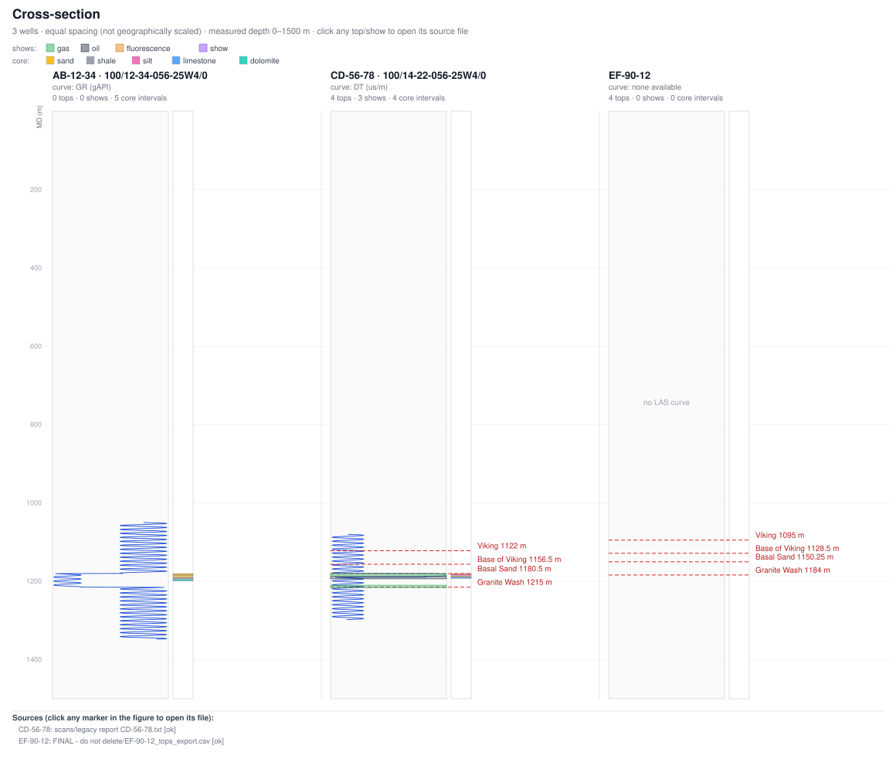

# wellcrawler

**Surface the wells hiding in `temp(14)`.**

Crawl a messy subsurface archive, standardize the records by well, and draw
the cross-section yourself — with every formation top one click from its
source file.

```
pip install -e .
wellcrawler crawl "examples/temp(14)"
wellcrawler ask "which wells have gas shows?"
wellcrawler cross-section -w "AB-12-34,CD-56-78,EF-90-12" -o xsec.svg
```



## The idea

This project is an independent, open-source implementation of the workflow
described in [NthDS's post](https://lnkd.in/p/ez_4ftYN):

> There's a generic folder called temp(14) in your shared drive. It contains
> checkshots, core, well logs for a basin you are exploring … but you have no
> idea that data is in there because it's "temp(14)". That can be costly!
> Drop it into Crawler and the files come back sorted, the records
> standardized by well. […] the cross-section draws itself: reported shows,
> formation tops and LAS curves at depth, side by side. Every top is one
> click from its source page.

Credit for the idea belongs to NthDS; this repo is not affiliated with or
endorsed by them. It exists because the problem — valuable data invisible
inside badly-named folders — is universal, and a deterministic, offline,
stdlib-only version of the workflow is useful to have in the open.

## What it does

1. **Crawls** any directory tree and classifies files by *content*, not by
   extension or folder name (a LAS saved as `run notes final.txt` is still a
   LAS).
2. **Parses** what it recognizes: LAS 1.2/2.0 well logs, checkshot tables,
   core description tables, tops tables, and paginated legacy text reports
   (formation tops, hydrocarbon shows, mud weights — anything tied to depth).
3. **Standardizes by well**: name variants and UWIs from different files
   (`AB-12-34`, `ab_12_34 core descriptions vFINAL.csv`,
   `100/12-34-056-25W4/0`) collapse into a single well record.
4. **Answers plain-English questions** about the archive, offline and
   deterministically.
5. **Draws the cross-section** as a standalone SVG — log curve tracks,
   formation tops, reported show bands and core lithology columns side by
   side on a shared depth axis — where **every top and show is a clickable
   link to its source file**, with a hover tooltip giving the exact page and
   line.
6. **Never lies about what it skipped**: unknown and failed files are
   ledgered with reasons in `wellcrawler sources`.

## Quickstart

```bash
git clone https://github.com/ojaogezi/wellcrawler
cd wellcrawler
pip install -e .            # no runtime dependencies — Python ≥ 3.10 stdlib only

# 1. crawl the demo archive (or point it at your own messy folder)
wellcrawler crawl "examples/temp(14)"

# 2. what do we have?
wellcrawler wells

# 3. ask questions
wellcrawler ask "which wells have gas shows?"
wellcrawler ask "where is the Basal Sand?"
wellcrawler ask "what data do we have for AB-12-34?"

# 4. draw the section
wellcrawler cross-section -w "AB-12-34,CD-56-78,EF-90-12" -o xsec.svg
```

Open `xsec.svg` in any browser. Click a red top marker — it opens the file
the depth was read from. Hover for the page/line and the verbatim excerpt.

The demo tree in `examples/temp(14)` is generated by
`examples/make_demo_data.py` and deliberately reproduces shared-drive
pathologies: misleading filenames, a LAS disguised as `.txt`, versioning
junk, a broken (wrapped) LAS, and outright junk files.

## How it works

```
messy directory ──▶ classify (content sniffing)
                     ├── LAS  ──▶ well header, curve tracks
                     ├── CSV  ──▶ checkshots / core / tops (fuzzy headers)
                     ├── text ──▶ paginated reports: tops, shows, mud weights
                     └── ?    ──▶ ledgered as unknown, with a reason
                              ▼
              standardize (normalize names, merge UWIs/aliases)
                              ▼
                   catalog.db (SQLite, one row per record,
                    every row carries source path + page + line)
                              ▼
        consume: wells · tops · shows · sources · ask · cross-section (SVG)
```

- **Catalog**: SQLite at `<root>/.wellcrawler/catalog.db`. Consuming verbs
  auto-discover the nearest catalog (or set `WELLCRAWLER_CATALOG`), and
  re-crawling is idempotent (unchanged files are skipped by hash; vanished
  files are pruned).
- **Well identity**: names are folded to `[A-Z0-9]` for merging; UWIs like
  `100/14-22-056-25W4/0` and `14-22-056-25W4` merge via their canonical
  land-grid part; display names are chosen from the most trustworthy source
  (LAS header > report title > table > filename).
- **Cross-sections**: equal spacing (clearly labelled as *not* geographic),
  shared measured-depth axis, GR/DT/density/resistivity preference order
  for the curve track, core lithology column coloured by rock type.

## Provenance model

Every extracted record stores `source path + page + line + excerpt`. That
means:

- `wellcrawler tops` prints `← scans/legacy report CD-56-78.txt (p.1, L.8)`
  next to each depth;
- `wellcrawler ask "where is the Basal Sand?"` answers with the same
  pointers;
- the SVG wraps each marker in `<a href="file://…">` so "check the depth
  yourself" is literally one click.

## Plain-English `ask`

Deterministic pattern matching — no LLM, no network, no keys. It handles:

- `which wells are in the archive?`
- `which wells have gas shows?` / `… oil shows?`
- `what tops does CD-56-78 have?`
- `where is the Basal Sand?`
- `what data do we have for AB-12-34?`
- `build a cross-section of AB-12-34, CD-56-78, EF-90-12` (prints the command)

Anything else gets an honest "I didn't understand that" with examples.

## Status & non-goals

v0.1 deliberately does **not** attempt: OCR of scanned pages or handwritten
notes (the text-page extractor is the seam where OCR would plug in), LAS 3.0
/ wrapped LAS / DLIS / SEG-Y, geographically scaled sections, or a server/UI.
See [`docs/superpowers/specs/2026-11-01-wellcrawler-design.md`](docs/superpowers/specs/2026-11-01-wellcrawler-design.md)
for the full design.

## Development

```bash
pip install -e ".[dev]"
pytest
```

CI runs the suite on Python 3.10–3.14.

## License

MIT — see [LICENSE](LICENSE).
